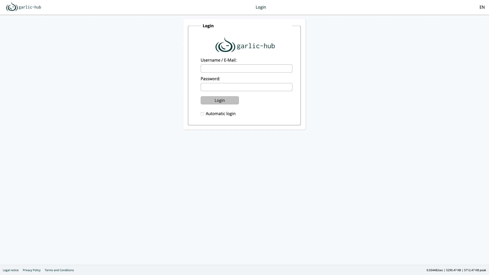

[](https://github.com/garlic-signage/garlic-hub/actions/workflows/docker-image.yml)
[](https://github.com/garlic-signage/garlic-hub/blob/main/misc/coverage.svg)
[](https://github.com/garlic-signage/garlic-hub/blob/main/misc/phpstan-level.svg)
[](https://github.com/garlic-signage/garlic-hub/blob/main/misc/php-version.svg)

# Garlic-Hub: Digital Signage Management

Garlic-Hub manages your digital signage network — devices, content and playlists —
from a single self-hosted interface. No SaaS, no per-device fees, no vendor lock-in.



## Part of the GarlicSignage Ecosystem

| Project                                                             | Role                                        |
|---------------------------------------------------------------------|---------------------------------------------|
| [garlic-player](https://github.com/garlic-signage/garlic-player)    | SMIL media player                           |
| **garlic-hub**                                                      | Device and content management ← you are here |
| [garlic-launcher](https://github.com/garlic-signage/garlic-launcher) | Root-free Android kiosk launcher           |
| [garlic-daemon](https://github.com/garlic-signage/garlic-daemon)    | systemd-based player maintenance            |
| [garlic-proxy](https://github.com/garlic-signage/garlic-proxy)      | Proxy for restricted networks               |

## Live Demo

See garlic-hub in action: https://garlic-hub.com

- login: `admin`
- password: `Demo1234!`

The demo is deleted and rebuilt regularly.

## Installation

- [User Installation Guide](https://garlic-signage.com/garlic-hub/installation/)
- [Connecting Media Players](https://garlic-signage.com/garlic-hub/docs/tutorials/connect-media-player/)
- [Proxmox LXC Helper Script](https://forge.canaryblue.org/CanaryBlue-Public/garlic-hub-lxc) (community contribution, maintained by @SB-CanaryBlue)

## Features

| Feature                   | Status | Description                                                                                                             |
|---------------------------|--------|-------------------------------------------------------------------------------------------------------------------------|
| **Media management**      | ✅      | Hierarchical folders, uploads from local files, external links, screencasts, camera and stock platforms (with API key) |
| **SMIL playlists**        | ✅      | Create playlists and export them in the industry-standard SMIL format                                                  |
| **Multi-zone content**    | ✅      | Graphical editor for display zones                                                                                     |
| **Template editor**       | ✅      | Image templates based on fabric.js                                                                                     |
| **Conditional play**      | ✅      | Date and time conditions for media playback                                                                            |
| **Triggers**              | ✅      | Play media or nested playlists by priority, triggered by access keys, touch/click, date/time or network                |
| **Local player**          | ✅      | Integration of one local media player                                                                                  |
| **Push**                  | ✅      | Push a playlist to a local player                                                                                      |
| **User management**       | ✅      | Basic user management with roles per module; initial admin user set up after installation                             |
| **Authentication**        | ✅      | Session login with remember-me and basic OAuth2 token authorization                                                    |
| **Internationalization**  | ✅      | UI in English, German, Spanish, French, Greek and Russian                                                              |

Planned work: [Milestones](https://github.com/garlic-signage/garlic-hub/milestones)

## Development

### Requirements

- PHP 8.4 with the extensions curl, fileinfo, imagick, intl, mbstring, openssl, simplexml and zip
- Composer
- SQLite or MariaDB
- Docker with [DDEV](https://ddev.com) (recommended for local development)

### Quick Start

```bash
git clone https://github.com/garlic-signage/garlic-hub.git
cd garlic-hub
ddev start
ddev composer install
cp .env.dist .env        # then fill in the values
ddev exec bash dev-install.sh
```

Then open https://garlic-hub.ddev.site and create the admin user. The full guide is in [docs/install.md](docs/install.md).

### Tests and Static Analysis

```bash
ddev exec vendor/bin/phpunit
ddev exec vendor/bin/phpstan analyze
```

`preCommit.sh` runs both, plus coverage report, coverage badge and SBOM.

### Tech Stack

- PHP 8.4 with strict types, PHPStan level 8, PHPUnit 12
- [Slim 4](https://www.slimframework.com) with PSR-7/PSR-15 middleware and [PHP-DI](https://php-di.org)
- [Doctrine DBAL](https://www.doctrine-project.org/projects/dbal.html) with SQL migrations
- [Mustache](https://github.com/bobthecow/mustache.php) templates
- league/oauth2-server, Flysystem, Monolog, phpfastcache, Symfony Console
- Vanilla JavaScript (ES modules) and a few external libraries such as fabric.js

## Developer Documentation

**Start here**
- [Architecture](ARCHITECTURE.md) — layers, request flow and every directory explained
- [Installation](docs/install.md)
- [Coding Standards](docs/coding-standards.md)

**Concepts**
- [Controller](docs/controller.md)
- [DI Container](docs/di-container.md)
- [Exceptions](docs/exceptions.md)
- [Input, Validation and Escaping](docs/escaping.md)
- [User Administration](docs/user-administration.md) — roles and access levels
- [API and OAuth2](docs/oauth2.md)
- [CLI](docs/cli.md)

**How-tos**
- [Paginator](docs/generic/datatable/paginator.md)
- [Connect a Media Player](docs/connect-media-player.md)

## Security

Vulnerability reports: see [SECURITY.md](SECURITY.md).

Before reporting, please read the [Threat Model](docs/threat-model.md). It
documents which properties garlic-hub protects, which behaviours are deliberate
design decisions arising from the constraints of unattended signage hardware,
and what is in and out of scope.

A CycloneDX SBOM is generated for each release and attached to the
[release assets](https://github.com/garlic-signage/garlic-hub/releases).

## Contributing

PRs and issues are welcome. The project is in active development, so code and APIs may still change.

## License

[GNU Affero General Public License v3.0](https://www.gnu.org/licenses/agpl-3.0.en.html)

Note: the AGPL requires that modifications — including server-side deployments —
are released under the same license.
